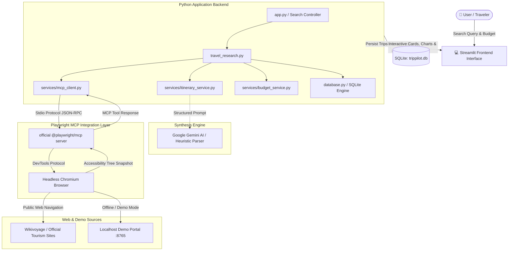

# TripPilot AI — AI Travel Research Agent Using Playwright MCP

TripPilot AI is an autonomous, beginner-friendly AI Travel Research Agent designed for student demonstrations and real-world travel planning. Built with **Streamlit**, the official **Playwright MCP (Model Context Protocol)** server, the **Python MCP SDK**, and **Google Gemini AI**, TripPilot AI browses public travel portals, extracts verified attractions and accommodation prices, synthesizes day-by-day itineraries, and computes realistic budget plans.

---

## 🏗️ System Architecture



---

## ✨ Core Features

1. **Travel Search Form:**
   - Destination, optional starting city, departure and return dates (with automatic return $\ge$ departure validation).
   - Party size (number of travelers), total trip budget in INR ($\text{₹}$).
   - Travel interests (Nature, Beaches, History, Shopping, Food, Nightlife, Relaxation).
   - Accommodation tiers (*Budget*, *Mid-range*, *Luxury*) and travel style (*Relaxed*, *Balanced*, *Packed*).
   - Quick Demonstration presets for instant 1-click test scenarios.

2. **Genuine Browser Automation via Playwright MCP:**
   - Connects to the official `@playwright/mcp` server using the Python MCP SDK (`mcp.client.stdio`).
   - Automatically discovers and exercises 25 native browser tools (`browser_navigate`, `browser_snapshot`, `browser_find`, etc.).
   - Extracts structured accessibility snapshots without fragile CSS selectors or heavy vision dependencies.

3. **Commute & Transit Intelligence:**
   - Evaluates multi-modal routes connecting the traveler's starting city to the destination.
   - Researches Flights, Superfast/Vande Bharat Trains, Overnight AC Sleeper Buses, and Road trips with estimated fares and durations.
   - Provides direct 1-click booking and fare-checking links to **Google Flights**, **MakeMyTrip / IRCTC**, **RedBus**, and **Google Maps Directions**.

4. **Editor's Handpicked Best Recommendations:**
   - Curated highlight block at the top of the results showcasing:
     - 🚆 **Best Commute Mode** (fastest and most cost-effective travel option)
     - 🏨 **Top Stay** with tailored justification for the budget tier
     - 🏛️ **Must-Visit Sights** (top 3 essential spots)
     - 🍲 **Signature Regional Food** to experience

5. **Multi-Source Accommodation & Direct Booking Deep-Links:**
   - Displays clean cards with property name, property type, location, star rating, verified per-night rate, and calculated total accommodation cost.
   - Direct booking search links to **Booking.com**, **Goibibo**, and **MakeMyTrip** — no generic repetitive URLs.
   - Direct 1-click **📍 View on Google Maps** pins for every property.

6. **Destination Explorer & Verification Badges:**
   - Comprehensive destination overview, popular attractions, and recommended activities.
   - High-quality destination and attraction imagery.
   - Grounded data: Every attraction item displays an honest **✓ VERIFIED SOURCE** badge or an **AI SUGGESTION** badge.
   - Direct **📍 View on Google Maps** buttons and links to original travel guides.

7. **Authentic Dining & Culinary Exploration:**
   - Regional dishes and top-rated local eateries with price ranges and descriptions.
   - Direct Google Maps links for instant turn-by-turn navigation.

8. **AI Itinerary Generator:**
   - Day-by-day plan with Morning, Afternoon, and Evening activities logically clustered to avoid excessive transit.
   - Specific food and restaurant recommendations with estimated daily costs and practical travel notes.
   - One-click export to Markdown format.

9. **Budget Planner:**
   - Itemized breakdown table covering Accommodation, Food & Dining, Local Transport, Activities & Tickets, and Miscellaneous Reserve.
   - Visual bar chart and budget utilization percentage.
   - Live interactive override form allowing travelers to adjust estimates and immediately see updated totals.

10. **SQLite Trip Persistence:**
    - Complete local persistence for past research sessions in `trippilot.db`.
    - Reload any past trip into the active session with one click, export to JSON, or delete.

---

## 🛠️ Technology Stack

| Component | Technology | Role |
| :--- | :--- | :--- |
| **Frontend** | Streamlit | Polished multi-page web application |
| **Language** | Python 3.10+ | Core application logic and orchestration |
| **Browser MCP** | `@playwright/mcp@latest` | Official Microsoft Playwright Model Context Protocol server |
| **MCP Client** | Python MCP SDK (`mcp`) | Stdio transport and tool invocation |
| **AI Model** | Google Gemini (`gemini-3.8-flash`) | Natural language synthesis and structured itinerary planning |
| **Data Processing** | Pandas | Budget summaries and charting DataFrames |
| **Data Storage** | SQLite (`database.py`) | Persistence for trips, preferences, and MCP audit logs |
| **Environment** | `python-dotenv` | Configuration management |

---

## 🚀 Quick Start Guide

### Prerequisites
1. **Python 3.10+** installed on your system.
2. **Node.js 18+** with `npx` available on your system `PATH` (used to execute the Playwright MCP server).

### 1. Clone & Set Up Directory
```bash
cd Bunny_MCP
```

### 2. Install Python Dependencies
```bash
pip install -r requirements.txt
```

### 3. (Optional) Configure Gemini AI API Key
Copy `.env.example` to `.env`:
```bash
cp .env.example .env
```
Add your free Gemini API key from [Google AI Studio](https://aistudio.google.com/):
```env
GEMINI_API_KEY=AIzaSy...
```
*(Note: If you do not provide a Gemini API key, TripPilot AI will seamlessly use its built-in rule-based heuristic extraction engine!)*

### 4. Verify MCP Server and Unit Tests
Run the comprehensive test suite to verify the MCP client, database, and budget calculator:
```bash
python -m unittest discover tests
```
You should see:
```text
Ran 10 tests in 13.7s ... OK
```

### 5. Launch TripPilot AI
Run the Streamlit application:
```bash
streamlit run app.py
```
Open your browser at `http://localhost:8501`.

---

## 🎓 Live College Demonstration Script

Follow these steps for a live presentation:

1. **Step 1: Check System Diagnostics**
   - In the app sidebar, note that **Playwright MCP** is ready.
   - Navigate to the **Settings** page (`5_Settings.py`) and click **"🧪 Test MCP Connection Now"**.
   - Show the audience that the Python MCP SDK established a connection with `@playwright/mcp` and discovered 25 native browser automation tools.

2. **Step 2: Load the Goa 3-Day Scenario**
   - Return to the **Home** page.
   - Click the preset button: **"🌴 Goa 3-Day Coastal (₹15,000)"**.
   - Observe how the form automatically populates with 2 travelers, ₹15,000 budget, and relevant travel dates.

3. **Step 3: Trigger Live Playwright MCP Research**
   - Click **"🚀 Research My Trip with Playwright MCP"**.
   - Expand the live logs to show the steps:
     1. Connecting to the MCP server.
     2. Navigating to the travel guide.
     3. Capturing the accessibility tree snapshot.
     4. Extracting verified attractions and hotels.
     5. Synthesizing the plan.

4. **Step 4: Inspect Destination & Accommodation Findings**
   - Click on **"1_Trip_Results"** in the sidebar.
   - Point out the **✓ VERIFIED SOURCE** badges, entry prices, and source URLs.
   - Point out the Stays tab showing published night rates vs total calculated accommodation costs.

5. **Step 5: Review Daily Itinerary & Budget**
   - Click on **"2_Itinerary"** to show the morning/afternoon/evening activity schedule.
   - Click on **"3_Budget_Planner"** to view the expense chart. Demonstrate the manual cost override form to show how the remaining budget dynamically updates.

6. **Step 6: Show SQLite Persistence**
   - Click on **"4_Saved_Trips"** to demonstrate that the trip was automatically saved to SQLite and can be reloaded or exported to JSON.

---

## 🔍 How Playwright MCP Works in TripPilot AI

The Model Context Protocol (MCP) standardizes how AI applications connect with external tools and environments:

1. **Stdio Transport:** The Python backend launches `@playwright/mcp` as a subprocess via standard input/output (`stdio`).
2. **Tool Handshake:** On startup, `session.initialize()` and `session.list_tools()` negotiate capabilities and expose browser automation primitives.
3. **Deterministic Navigation:** Instead of fragile pixel coordinate clicks or raw HTML scraping, Playwright MCP executes `browser_navigate` and `browser_snapshot`.
4. **Accessibility Tree:** `browser_snapshot` captures a lightweight YAML/text accessibility tree (roles, headings, labels, and text), allowing the agent to read real prices and timings cleanly without downloading heavy advertising scripts or triggering aggressive bot hurdles.

---

## 🔧 Troubleshooting Guide

| Issue | Cause | Solution |
| :--- | :--- | :--- |
| `npx: command not found` | Node.js is not installed or not in PATH | Install Node.js from [nodejs.org](https://nodejs.org/) and restart your terminal. |
| `HTTP status: 429` on live sites | Wikivoyage rate limit | Check the "Use Verified Travel Guide Portal" checkbox in the search form to use the local demo portal. |
| `Gemini API key missing` | No `.env` key provided | Either add `GEMINI_API_KEY` in `.env` or input it in the Settings UI tab. The app will use the heuristic parser otherwise. |
| Port 8765 in use | Previous demo server instance running | The demo server automatically detects existing instances and safely reuses the port. |

---

## 📄 License
Educational Capstone Project — Free for learning and academic demonstration.
